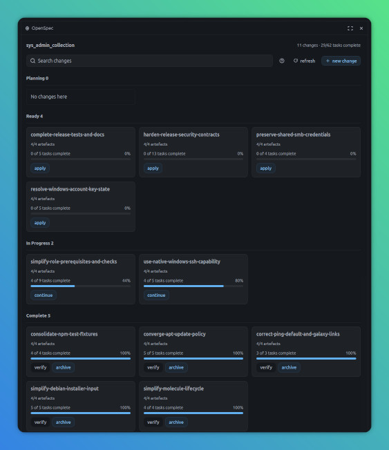
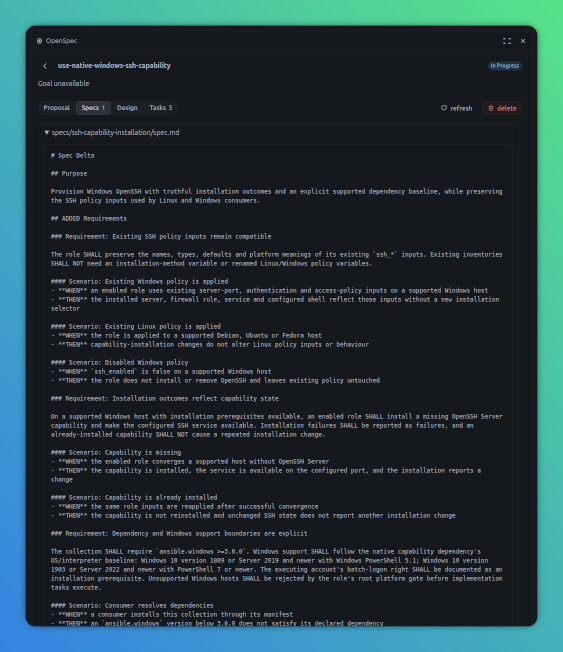

# OpenSpec for OpenChamber

A kanban board for the OpenSpec changes in your OpenChamber project or worktree. See each change's
stage, artefacts and task progress in one place, create or delete changes, and kick start the next
workflow step.

This extension is simply another way to use OpenSpec, without adding planning features or
conventions of its own. OpenSpec's own CLI and skills remain the core.

Contributions that keep this extension in step with OpenSpec or take advantage of it's additional
features are welcome.

## Get started

The extension requires OpenChamber 2.7.1 or later.

1. Install the [OpenSpec CLI](https://openspec.dev/docs/installation) on the OpenChamber server
   (tested with 1.13.1 and 2.1.0).
2. Run `openspec config profile` and choose skills delivery. Add **verify** if you want the
   **verify** action on completed changes.
3. In your project, run `openspec init --tools opencode`.
4. In OpenChamber, open **Settings > Extensions** and add
   `https://github.com/jaythomasonprojects/openchamber-openspec.git`. Its service runs `openspec`
   with your user access, and the `sessions` permission lets it start sessions for worktree Apply
   and bulk archiving. If you trust that, choose **Allow and enable**.
5. Open the **OpenSpec** rail panel, or find it under **Extension pages**.

The board's help button opens the OpenSpec quickstart. For ~ x2 faster loads, run
`openspec config set telemetry.enabled false`, since telemetry can slow down every CLI call.

## Browse changes and specs

Use **Changes** to work on active changes, **Archived** to read past changes' dates and task counts,
and **Specs** to read the project's main OpenSpec specs. **Archived** requires OpenSpec 2.x.

Board actions follow the workflows you select with `openspec config profile`. Planning changes offer
**ff** if configured, then **continue** if configured, or **propose**. Completed changes offer
**verify** only if you configure that workflow. **archive all** uses **bulk-archive** if configured.
Run `openspec update` after changing the profile to install the selected skills.

## Track changes from Work Status

Open **Work Status > OpenSpec** to see task progress for the current session. Select **＋ Track a
change** to add another active change. To remove one, select its name and then **Untrack**. Your
choices follow the session on devices connected to the same server.

Expand **Tasks:** to see up to five tasks around the current task. Select a task title to read its
description. The workflow chips follow the change's stage and the profile set by
`openspec config profile`. Optional workflows such as **ff** and **verify** appear when configured.
Run `openspec update` after changing the profile to install the configured skills. If the CLI cannot
report the profile, the section uses the core workflows. Workflow chips prepare drafts without
sending them. **validate** runs OpenSpec validation and previews the result. For the full report,
run `openspec validate <change> --type change --json`.

The footer contains **＋ Track a change**, **new** (when configured), **board**, and **Refresh**.
**board** opens the board without changing its current view. To open a specific change, select its
name and then **Open in board**. The section also refreshes when the session finishes a turn. On
touch screens, chips are 28px tall with 8px gaps, and the footer fits on one text line. The board
keeps its 44px touch targets.

The Work Status section and phone board require OpenChamber 2.7.1 or later. On a phone, open the
board from the workspace drawer or the sessions list's **More** menu.

## Planning across worktrees

Commit your `openspec/` directory and worktrees pick up changes through Git like any other file.
**Run in new worktree** starts from your project's default base, so commit the change there first.

Optionally, to share uncommitted planning between worktrees, use your project's setup hook to link
each worktree's `openspec/` to the main checkout's. The board follows the link but does not create
or repair it.

## Develop

Requires Node 22.13+, npm and the OpenSpec CLI. Run `npm ci`, `npx playwright install chromium`,
then `npm run check`. OpenChamber does not build extensions on install, so rebuild, then disable and
re-enable the extension to restart its service. More detail is in `AGENTS.md`.
